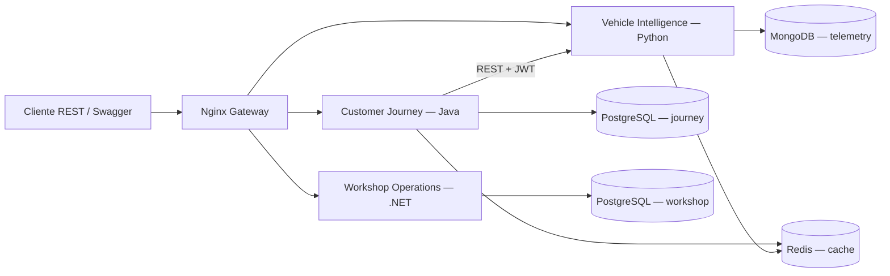
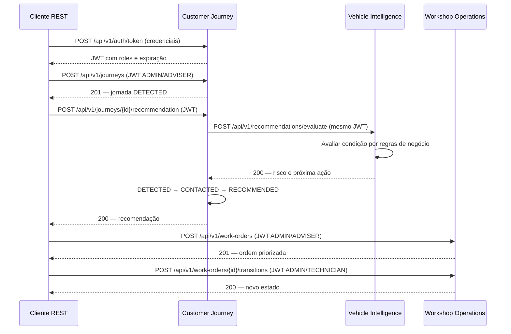

# Arquitetura da solução — SOA

## Componentes e responsabilidades



| Serviço | Responsabilidade | Organização |
|---|---|---|
| Customer Journey | JWT, jornadas, estados e solicitação de recomendações | Domínio, aplicação, ports e adapters REST/JPA |
| Vehicle Intelligence | Dados do veículo, regras de risco e recomendações | Domínio, aplicação, pipeline de regras, adapters HTTP/persistência |
| Workshop Operations | Ordens, prioridade e estados | Domain, Application, Infrastructure e Web |

Cada serviço controla seus dados. Os bancos `journey` e `workshop` compartilham a instância PostgreSQL da POC, com estruturas separadas. MongoDB guarda dados do veículo e recomendações; Redis mantém cache com TTL de cinco minutos. Nginx encaminha chamadas pelos prefixos `/journey`, `/intelligence` e `/workshop`.

## Fluxo de comunicação



Java → Python é a integração síncrona implementada. O cliente cria e acompanha a ordem na API de oficina; a POC não cria essa ordem automaticamente a partir da jornada. O adapter Java possui timeout, retry limitado e circuit breaker; indisponibilidade da API de recomendações retorna 503.

## Autenticação e autorização

Customer Journey emite JWT HS256 com `iss=ford-zero-touch`, `aud=ford-api`, `sub`, `roles`, `iat` e `exp` de uma hora. Os serviços usam o mesmo segredo local. Python e .NET verificam issuer e audience; Java valida assinatura e validade temporal. Login, health e Swagger são públicos. A autorização demonstrada é por perfil; consultas não filtram a titularidade do cliente na POC.

| Operação | Roles |
|---|---|
| Criar/avançar jornada e solicitar recomendação | ADVISER, ADMIN |
| Consultar jornada | CUSTOMER, ADVISER, ADMIN |
| Enviar dados do veículo | VEHICLE, ADMIN |
| Avaliar recomendação diretamente | ADVISER, ADMIN, SERVICE |
| Consultar risco | CUSTOMER, ADVISER, ADMIN, SERVICE |
| Criar ordem | ADVISER, ADMIN |
| Consultar ordem | CUSTOMER, ADVISER, TECHNICIAN, ADMIN |
| Avançar ordem | TECHNICIAN, ADMIN |

## REST e erros

Rotas versionadas em `/api/v1`: GET consulta; POST cria recursos ou solicita operações de negócio. Criação de jornada/ordem retorna 201 com `Location`; recebimento de dados retorna 202; consultas e transições retornam 200. Sem autenticação: 401; role insuficiente: 403; recurso ausente: 404. Validação de entrada Java/.NET retorna 400; validação Python e violações de regras de negócio retornam 422.

As três APIs usam Problem Details, com `Content-Type: application/problem+json` e os campos `type`, `title`, `status`, `detail` e `instance`. O mesmo formato cobre autenticação, autorização, validação, recurso ausente e falhas inesperadas. O campo `type` segue `https://ford.example/problems/{status}`; `instance` indica a rota local do serviço, sem o prefixo do gateway. Mensagens de negócio podem variar entre serviços, mantendo esse contrato. Falhas inesperadas retornam uma mensagem genérica, sem expor detalhes internos.

Exemplo de resposta Java sem token:

```json
{
  "type": "https://ford.example/problems/401",
  "title": "Unauthorized",
  "status": 401,
  "detail": "A valid bearer token is required.",
  "instance": "/api/v1/journeys"
}
```

O Swagger Java declara o login com `security: []`, enquanto os recursos protegidos herdam a exigência de Bearer JWT. Os testes conferem essa distinção. A API Python também documenta o schema de Problem Details para seus erros.

## Padrões e fontes

Aggregate Root e Value Objects protegem invariantes; Ports & Adapters e Repository isolam regras de HTTP/persistência. Pipes & Filters divide a avaliação por regras. State controla ordens; Strategy calcula prioridade. Cache-Aside reduz leituras; Retry/Circuit Breaker limitam falhas na integração.

Fontes: `compose.yml`, configurações de segurança, `JourneyService`, `HttpIntelligenceClient`, routers Python e controllers .NET. Decisões detalhadas em [ADR 001](adr/001-polyglot-bounded-contexts.md), [ADR 002](adr/002-polyglot-persistence.md) e [ADR 003](adr/003-sync-resilience.md).
